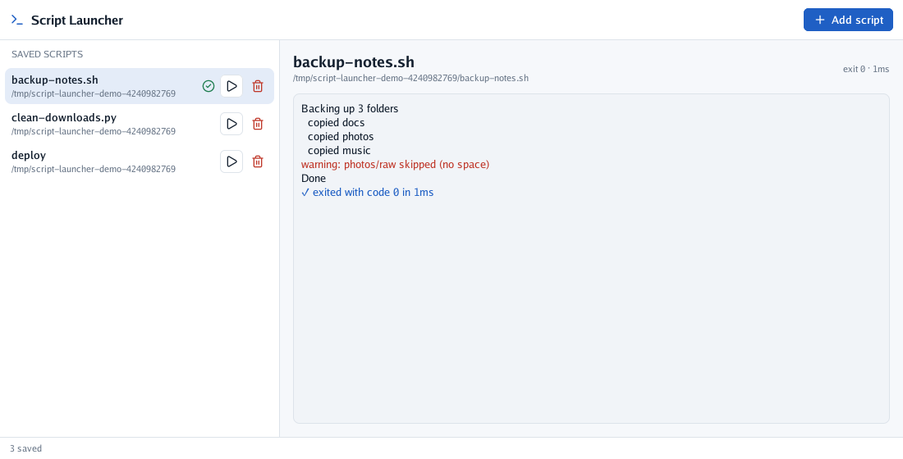

<div align="center">

# Script Launcher

**A desktop window to save your scripts and run them with one click.**
Pick a script once and it stays in the list; press ▶ and its output shows up live, with errors in
red and the exit code at the end. It is a single Go program drawn with [Go UI](https://github.com/akrck02/go-ui) and needs no browser or server.

[](go.mod)


[](LICENSE)

</div>

> **Note:** written with an AI assistant and pending thorough review. See the [AI disclosure](#-ai-disclosure).

## 🤖 AI disclosure

I write most of my code by hand, so I want to be clear about this project: **it was written by an
AI assistant (Claude, by Anthropic) under my direction, in November 2026.** I decided what to build
and how it should behave; the AI wrote the code, the tests and the docs. Every commit made this way
carries a `Co-Authored-By: Claude` line.

**Status: pending thorough review.** It builds, `go test -race ./...` passes (including UI tests
that click the real buttons in a headless window), and the pictures below were captured from the
real window. I have not yet reviewed it line by line. Treat it as a working draft, not as code I
vouch for.

> ⚠️ **Warning:** an educational experiment, **not suitable for production use**. APIs will break.

---

<p align="center">
<picture>
  <source media="(prefers-color-scheme: dark)" srcset="docs/images/hero-dark.png">
  
</picture>
<br>
<sub>A finished run: standard output in the body colour, standard error in red, the launcher's own notes in blue.</sub>
</p>

## 🚀 Quick start

```bash
go run ./cmd/script-launcher                 # open the window (-dark for the dark theme)
go run ./cmd/script-launcher -config my.json # keep the list in another file
go build -o bin/script-launcher ./cmd/script-launcher   # a binary to put in your PATH
go test -race ./...                          # run the tests
go run ./cmd/screenshots                     # redraw the pictures in docs/images
```

Press **Add script**, choose a file, then press ▶ on its row. The list is saved in
`~/.config/script-launcher/scripts.json`.

It needs Go 1.25 or newer, cgo, and a display with OpenGL 4.1 (GLFW is built in).

[More on getting started →](docs/02-get-started.md)

## 🔍 How it works

Each frame, the view reads the saved list and each script's latest run and describes the window
again (Go UI is immediate mode). Pressing ▶ asks the run service to start the script in its own
folder and process group; two goroutines copy its standard output and error, line by line, into
the run and wake the window, which then draws the new lines. ■ sends `SIGTERM` to the whole group.
Which program runs a file is decided by a registry of runners: `.sh` with bash, `.py` with
python3, `.js` and `.ts` with node, and anything else with the executable bit, directly.

[More on the design →](docs/03-modules.md)

## 📚 Documentation

| | |
|---|---|
| [Overview](docs/01-overview.md) | What the launcher does, and what it does not do yet. |
| [Get started](docs/02-get-started.md) | Build it, add a script, run it, and where the list is kept. |
| [Modules](docs/03-modules.md) | The layers, how they connect, and how to add a new kind of script. |
| [Roadmap](docs/04-roadmap.md) | What could come next. |

## Licence

MIT, see [LICENSE](LICENSE).
