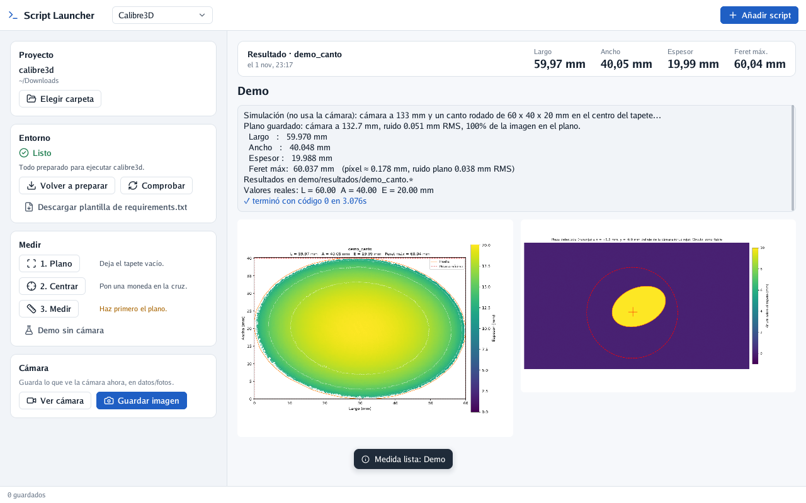

# Primera instalación (macOS y Fedora)

---

Esta guía es para dejar listo un ordenador recién sacado de la caja: instalar lo necesario, conectar
la cámara RealSense D405 y hacer la primera medida con Script Launcher. No hace falta saber
programar. Donde haya que escribir algo en la terminal, cópialo y pégalo tal cual.

Sigue solo los pasos de tu sistema: **macOS** (un Mac) o **Fedora** (Linux).

## Qué necesitas

- El ordenador, con conexión a internet.
- La cámara **Intel RealSense D405** y su cable USB-C. Conéctala directamente al ordenador, sin
  hubs ni alargadores.
- La carpeta del proyecto **calibre3d** (te la pasarán en un USB o en una descarga). Es la carpeta
  que contiene `prueba.sh`, `requirements.txt` y otra carpeta llamada `calibre3d`.
- El tapete impreso y la cámara montada a unos 133 mm sobre él (lo explica el `README.md` del
  proyecto).

## 1. Instalar Python

Script Launcher usa Python para hablar con la cámara y hacer las medidas.

**macOS**

1. Entra en [python.org/downloads](https://www.python.org/downloads/) y pulsa el botón amarillo
   **Download Python 3.x**.
2. Abre el archivo descargado (`python-3.x-macos11.pkg`) y pulsa **Continuar** hasta el final.
3. Al terminar se abre una carpeta de Python: haz doble clic en **Install Certificates.command**.
   Se abre una ventana negra; cuando diga que ha terminado, ciérrala.

No uses el Python que el Mac ofrece instalar con las «herramientas de desarrollo»: Script Launcher
busca primero el de python.org.

**Fedora**

Ya viene instalado. No hay que hacer nada.

## 2. Dar permiso para usar la cámara

**Fedora**

Linux no deja usar la cámara a un usuario normal hasta que se le dice que es de confianza. Abre la
aplicación **Terminal** (búscala en el menú), pega estas tres líneas y pulsa Intro. Te pedirá tu
contraseña:

```bash
sudo curl -L -o /etc/udev/rules.d/99-realsense-libusb.rules https://raw.githubusercontent.com/IntelRealSense/librealsense/master/config/99-realsense-libusb.rules
sudo udevadm control --reload-rules
sudo udevadm trigger
```

Después **desconecta la cámara y vuelve a conectarla**.

**macOS**

No hay que instalar nada. Si al ver la cámara aparece un error de permisos USB, mira
[Si algo falla](#si-algo-falla).

## 3. Descargar Script Launcher

Entra en la página de descargas:
**[github.com/Itros97/script-launcher/releases/latest](https://github.com/Itros97/script-launcher/releases/latest)**

**macOS**

1. Descarga **ScriptLauncher-macOS.zip**. Sirve para todos los Mac (M1–M4 e Intel).
2. Abre el zip: aparece **Script Launcher**. Arrástralo a la carpeta **Aplicaciones**.
3. La primera vez, el Mac dirá que no puede comprobar el desarrollador. Es normal: la app no está
   firmada con una cuenta de pago de Apple. Para abrirla:
   - Abre **Ajustes del Sistema → Privacidad y seguridad**.
   - Baja hasta el aviso sobre «Script Launcher» y pulsa **Abrir igualmente**.
   - Confirma con **Abrir**. Solo hay que hacerlo una vez.

**Fedora**

1. Descarga **script-launcher-linux-x86_64.tar.gz**.
2. Abre la carpeta Descargas, haz clic derecho en el archivo y elige **Extraer aquí**.
3. Abre la **Terminal** y pega:

   ```bash
   bash ~/Descargas/script-launcher-linux-x86_64/install.sh
   ```

   Si tu sistema está en inglés, la carpeta se llama `Downloads` en vez de `Descargas`.
4. Script Launcher ya aparece en el menú de aplicaciones.

## 4. Poner el proyecto calibre3d en su sitio

Copia la carpeta **calibre3d** a tu carpeta **Documentos** (en Fedora, `Documentos`; en Mac,
`Documentos` también). Así no se pierde entre las descargas.

Dentro de esa carpeta deben verse, al menos, `prueba.sh`, `requirements.txt` y otra carpeta
`calibre3d`.

## 5. Preparar Calibre3D en Script Launcher

1. Abre **Script Launcher**.
2. Arriba a la izquierda, en el desplegable, elige **Calibre3D**.
3. En la tarjeta **Proyecto**, pulsa **Elegir carpeta**. Se abre un selector (sus botones están en
   inglés): pulsa **Home** a la izquierda, haz clic en **Documentos** y luego en **calibre3d** (la
   de fuera, la que tiene `prueba.sh`) para entrar en ella, y pulsa **Choose**.
4. En la tarjeta **Entorno**, pulsa **Preparar entorno**. A la derecha verás cómo se instala todo.
   Tarda unos minutos y descarga unos 300 MB.
5. Cuando termine, el entorno dice 🟢 **Listo**.

## 6. Comprobar que todo funciona

1. En la tarjeta **Medir**, pulsa **Demo sin cámara**. En unos segundos aparecen arriba las medidas
   de una pieza simulada (unos 60 × 40 × 20 mm) y, debajo, su mapa de calor. Si lo ves, el
   programa funciona.
2. Con la D405 conectada, en la tarjeta **Cámara** pulsa **Ver cámara**. A la derecha debe verse lo
   que ve la cámara. Pulsa **Parar cámara** cuando acabes.

<p align="center">
  
</p>

## 7. Medir una pieza

Calienta la cámara unos 10 minutos antes de empezar: la medida cambia un poco con la temperatura.

1. **1. Plano**: deja el tapete vacío y pulsa el botón. Se hace una vez al empezar la sesión.
2. **2. Centrar**: pon una moneda sobre la cruz del tapete y pulsa. A la derecha dice cuánto mover
   el tapete; muévelo y repite hasta que diga «Centrado».
3. **3. Medir**: pon la pieza dentro del círculo, pulsa, escribe un nombre (por ejemplo
   `muestra_001`, sin espacios) y pulsa **Guardar**. Arriba aparecen el largo, el ancho, el espesor
   y el Feret; debajo, el mapa de calor.

Todo se guarda en la carpeta del proyecto, en `datos/resultados/`. Las fotos de **Guardar imagen**
van a `datos/fotos/`.

## Si algo falla

| Lo que ves | Qué hacer |
|---|---|
| «No encuentro python3» | En Mac, instala Python desde python.org (paso 1) y vuelve a abrir Script Launcher. |
| «Sin proyecto» o «En esta carpeta no está el programa calibre3d» | Pulsa **Elegir carpeta**, entra en la carpeta calibre3d de fuera (la que tiene `prueba.sh`) y pulsa **Choose**. |
| «Esta carpeta tiene prueba.sh pero le falta la carpeta calibre3d/» | Falta parte del proyecto: vuelve a copiar la carpeta completa. |
| «Incompleto» con «Falta la librería…» | Pulsa **Preparar entorno** otra vez. Si se repite, añade la librería que dice a `requirements.txt`. |
| La instalación falla con errores de red | Comprueba la conexión a internet y pulsa **Preparar entorno** otra vez. |
| «No se encuentra ninguna RealSense conectada» | Conecta la cámara directamente al ordenador, sin hub. En Fedora, repite el paso 2 y reconecta la cámara. |
| En Mac, un error de permisos USB al usar la cámara | Por verificar en un Mac: en algunas versiones de macOS la librería de la cámara necesita permisos de administrador. Avisa a quien te pasó el programa. |
| En Mac, la instalación dice que no encuentra `pyrealsense2` | Por verificar en un Mac: puede que tu versión de Python aún no tenga la librería de la cámara. Avisa a quien te pasó el programa con el texto rojo de la derecha. |
| La medida da avisos en naranja («Pieza lejos del centro»…) | Lee el aviso: suele bastar con centrar la pieza o repetir el plano. |

> **Nota:** la parte de macOS no se ha probado todavía en un Mac con la D405. Si algo no coincide
> con lo que ves, apúntalo y pásalo para corregir la guía.
